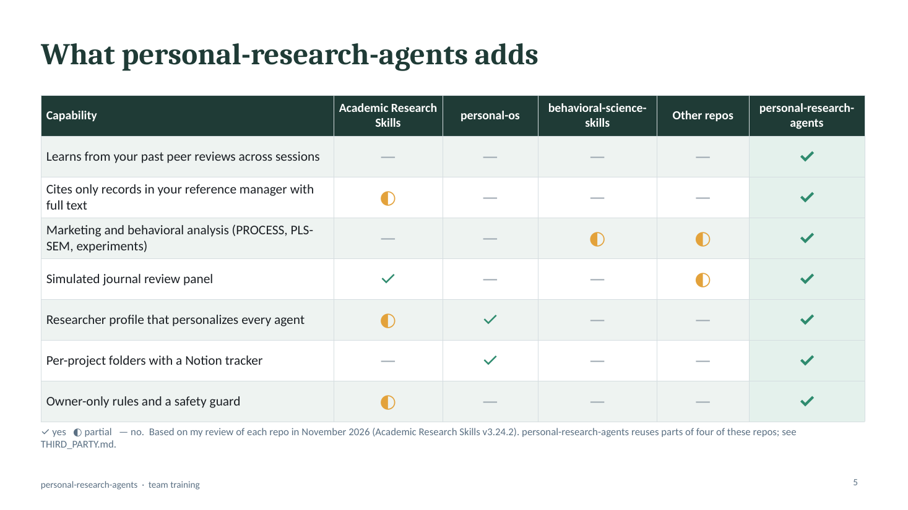
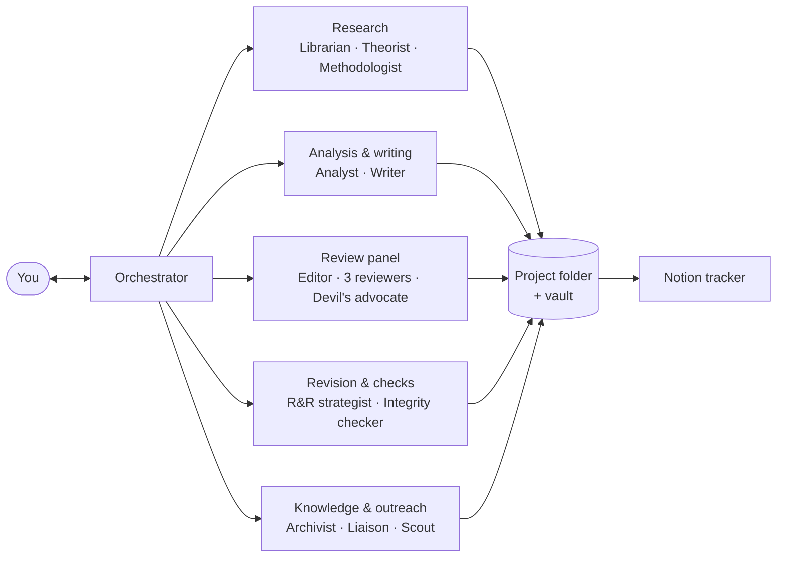
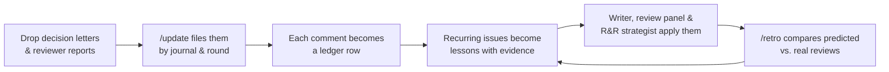
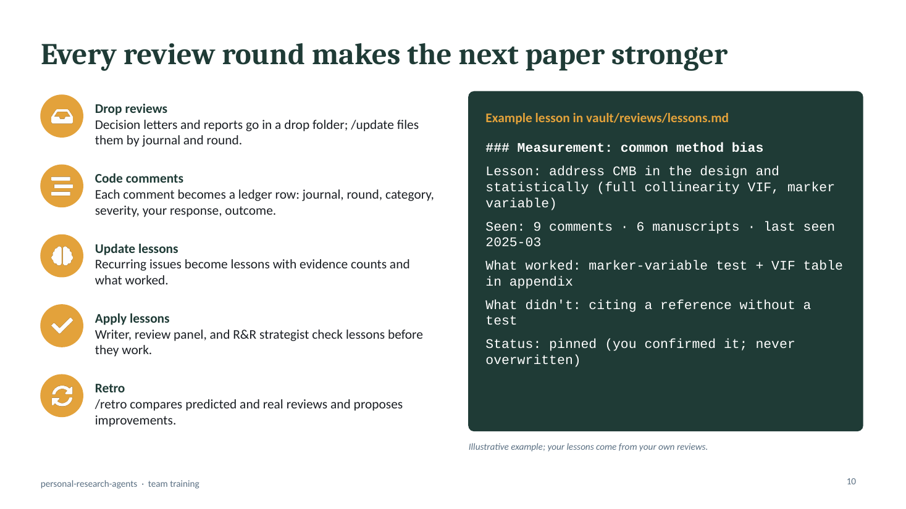
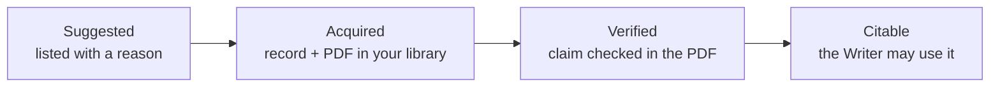
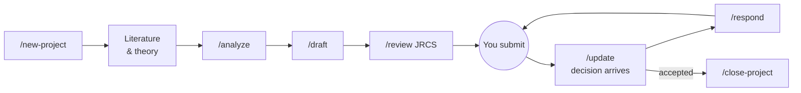
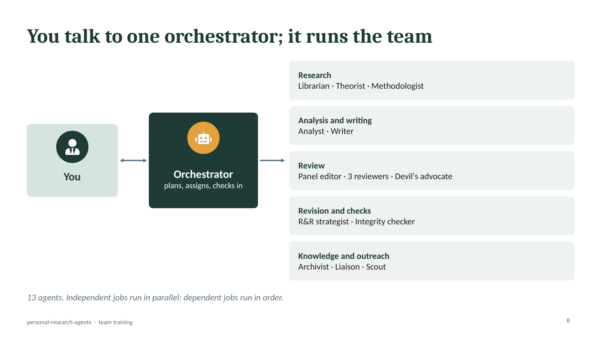
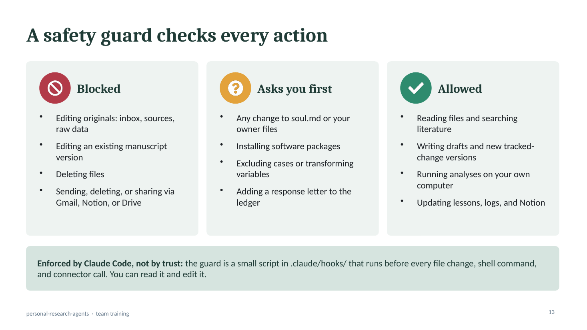

# personal-research-agents

**A personal AI research team for marketing, consumer behavior, and behavioral science, one that learns from every peer review you have ever received.**

personal-research-agents is a free [Claude Code](https://docs.claude.com/en/docs/claude-code/overview) template. You talk to one Orchestrator in plain language. It runs a team of 13 specialist agents that search the literature, design studies, run your analyses (PROCESS, PLS-SEM, experiments), draft in your own voice, simulate a journal's review panel, and handle revise-and-resubmit rounds.

Most AI research tools start from zero every time. This one keeps a record of what reviewers have told you, journal by journal and round by round, and checks your next manuscript against it before anyone else sees it.

> No coding needed. You drop files into a folder, type a command like `/update` or `/review`, and approve what the agents propose.

---

## Contents

- [Why this exists](#why-this-exists)
- [What makes it different](#what-makes-it-different)
- [How it works](#how-it-works)
- [The learning loop](#the-learning-loop-every-review-makes-the-next-paper-stronger)
- [Honest citations](#honest-citations-four-gates)
- [You stay in charge](#you-stay-in-charge-the-safety-guard)
- [Commands](#twelve-commands)
- [A project from idea to publication](#a-project-from-idea-to-publication)
- [Analysis stack](#analysis-stack)
- [The vault](#the-vault-who-writes-what)
- [Notion trackers](#notion-trackers)
- [Getting started](#getting-started)
- [Repository map](#repository-map)
- [Training deck](#training-deck)
- [Status and roadmap](#status-and-roadmap)
- [FAQ](#faq)
- [Credits and licenses](#credits-and-licenses)

---

## Why this exists

I started by looking for the best AI research repo on GitHub. [Academic Research Skills](https://github.com/Imbad0202/academic-research-skills) (about 55k stars) was the strongest: a full research-to-publication pipeline with a simulated review panel. But it is built for every field at once, and by design it forgets everything when a session ends. I couldn't find anything built for marketing or behavioral research with more than a few hundred stars. Nothing learned from a researcher's own review history.

So I collected seven repos, compared their skills, structure, and workflow side by side, and combined the best ideas: the personalization of `personal-os`, the research engine of Academic Research Skills, and the behavioral-analysis skills of three smaller projects. Then I added the missing piece, a memory of your peer reviews that keeps growing.

---

## What makes it different

| | What it means for you |
|---|---|
| 🧠 **It learns from your reviews** | Every reviewer comment you add is coded into a ledger, and recurring issues become lessons with evidence counts, for example *"common method bias raised in 9 comments across 6 manuscripts; what worked: marker-variable test plus a VIF table."* Every agent checks these lessons before drafting, simulating a review, or writing a response letter. |
| 🪪 **It knows you** | `/setup` builds a one-page researcher profile (`soul.md`) from your CV, papers, ORCID/OpenAlex record, and a short interview. It covers your agenda, the theories you use and avoid, your methods standards, and your writing style, so drafts sound like you. |
| 📚 **It cites honestly** | Agents can suggest any paper, but they write only with records already in **your** reference manager (EndNote, Zotero, or Mendeley) that have the full text attached and whose claims were checked in the PDF. A script verifies every citation before a draft is done. |
| 🛡️ **You stay in charge** | You own the rules and your profile. A safety guard enforced by Claude Code blocks edits to your originals, deletions, and any sending, deleting, or sharing through Gmail, Notion, or Drive. Agents suggest, draft, and file. They never submit or send. |
| 🧪 **Built for behavioral research** | PROCESS models, PLS-SEM (seminr, cSEM, PLSpredict, SmartPLS cross-checks), CB-SEM, experiments and ANOVA, and power analysis, all run on your own computer as reproducible Quarto reports. |
| 🗂️ **One folder per study, one dashboard for all** | `/new-project` creates a self-contained project folder with its own instructions, and Notion shows every project, task, and submission round at a glance. |

<p align="center"></p>

<sub>Comparison from my review of each repo in November 2026. This project reuses parts of four of them; see <a href="THIRD_PARTY.md">THIRD_PARTY.md</a>.</sub>

---

## How it works

You never manage agents directly. You tell the Orchestrator what you want, for example *"get the circular economy paper ready for JRCS."* It splits the work into jobs, runs the independent ones in parallel, and comes back with a summary and the decisions only you can make.



### The team

| Agent | What it does |
|---|---|
| **Orchestrator** | Plans the work, assigns agents, runs independent jobs at the same time, checks in with you, and updates status and Notion |
| **Archivist** | Files everything new, renames review documents by journal and round, codes every reviewer comment, and keeps the lessons current |
| **Librarian** | Searches your library first, then OpenAlex, Consensus, and the web; moves papers through the citation gates; verifies claims in PDFs |
| **Theorist** | Framing, theoretical lens, hypotheses, and the contribution statement, consistent with the theories you use and avoid |
| **Methodologist** | Study design, manipulations and checks, measures (reusing your validated scales), power analysis, and preregistration drafts |
| **Analyst** | Data cleaning and analysis in R or Python on your computer, with a fixed seed and a written rationale for every statistical choice |
| **Writer** | Drafts and revises in your voice for the target journal and saves every edit as a new Word version with tracked changes |
| **Panel editor** | Desk-screens the manuscript for a named journal, then turns the reviewers' reports into a decision letter and revision roadmap |
| **Panel reviewer** ×3 | Independent methodology, domain, and perspective reviewers, each checking your review history first |
| **Devil's advocate** | Builds the strongest honest case for rejection, so you hear it before a real reviewer says it |
| **R&R strategist** | Parses real reviews, recommends accept, partially accept, or respectfully disagree for each comment, and drafts the response letter and comment matrix |
| **Integrity checker** | The final gate: every citation against your library and PDFs, every number against the analysis output, and known AI-research failure modes |
| **Liaison** | Keeps coauthor pages current from OpenAlex, email, and calendar, drafts (never sends) follow-ups, and prepares meeting briefs |
| **Scout** | Scheduled watches: journal decision emails, new papers in your streams, papers citing yours, and calls for papers |

---

## The learning loop: every review makes the next paper stronger



- **Bring your history.** Put each past manuscript in its own folder with every version, decision letter, reviewer report, and response letter. No renaming is needed; the Archivist works out the journal, round, and reviewer from the content.
- **The ledger** (`vault/reviews/ledger.csv`) records every comment with its journal, round, category, severity, your response, and the outcome.
- **The lessons** (`vault/reviews/lessons.md`) show what reviewers keep asking for, which responses worked, and which journals weigh each issue most. A lesson you edit or pin is never overwritten.
- **The system learns from what you actually submitted.** AI drafts are kept as records only. The response letter enters the ledger after you confirm it is the version you sent.
- **Journal profiles** build up turnaround times, desk-reject triggers, and what each journal's reviewers asked you for.
- **`/close-project`** turns a finished paper into reusable knowledge: validated measures with the reliability you obtained, analysis code, dataset cards, theory notes, reusable passages, and future ideas taken from your limitations section.

<p align="center"></p>

---

## Honest citations: four gates

AI tools invent and misattribute references. Here, a reference moves one gate at a time, and only the last gate lets it into a manuscript.



- The Librarian always checks **your** library first. With EndNote you can keep **one library per project**: the `.enl` file, its `.Data` folder, and an XML export live in the project's `library/` folder, which agents can read but never change.
- Legal open-access PDFs are downloaded for you; everything else goes on your to-download list.
- EndNote drafts use record-number citations such as `{Dang, 2024 #312}`, so a citation can't point to a record that doesn't exist. Cite While You Write formats them.
- `/cite-check` runs a script that reads EndNote XML, RIS, BibTeX, and CSL JSON exports. It flags anything missing, ambiguous, or without full text.

---

## You stay in charge: the safety guard

`.claude/hooks/guard.sh` runs before **every** file change, shell command, and connector call. Claude Code enforces it, so an agent can't talk its way around it.

| Blocked | Asks you first | Allowed |
|---|---|---|
| Editing originals (inbox, sources, raw data, reference libraries) | Any change to `soul.md` or your owner files | Reading files and searching literature |
| Editing an existing manuscript version | Installing software packages | Writing drafts and new tracked-change versions |
| Deleting files | Excluding cases or transforming variables | Running analyses on your own computer |
| Sending, deleting, or sharing through Gmail, Notion, or Drive | Adding a response letter to the ledger | Updating lessons, logs, and Notion |

Other protections built into the agents:
- Agents that don't need outside services can only use file tools.
- Participant data never leaves your computer.
- Reviewer mode checks the journal's AI policy and never uploads a manuscript you are reviewing for someone else.
- Agents never edit your rules; they propose changes in `vault/suggestions.md`, and you decide.

**Manuscript versioning:** the Writer never edits your file. Every change creates `manuscript_v{N+1}_mmddyyyy.docx` with Word tracked changes and a comment explaining each edit, such as *"R2.3: softer causal claim"*. You accept or reject in Word.

---

## Twelve commands

You can always just describe what you want. These are shortcuts for the most common jobs.

| Command | What it does |
|---|---|
| `/setup` | One-time onboarding: your profile, reference manager, accounts, journals, past manuscripts, Notion, and optional automations |
| `/new-project` | Creates a study folder with its own CLAUDE.md, a library group, and a Notion row |
| `/update` | Files and learns from anything new (files, pasted text, links); `--refresh` pulls new publications, citing papers, and journal guideline changes |
| `/status` | Snapshot across projects: deadlines, R&R rounds, waiting on coauthors, refs to download; `--brief` for a Monday brief |
| `/analyze` | Plans or runs an analysis locally as a reproducible Quarto report |
| `/draft` | Writes or revises in your voice, saved as a new tracked-change version |
| `/cite-check` | Checks every citation against your library and PDFs |
| `/review <journal>` | Simulated pre-submission review: desk screen, three reviewers and a devil's advocate in parallel, then a decision letter |
| `/respond` | R&R: response plan, response letter, comment matrix, and tracked-change edits |
| `/close-project` | Harvests a finished project into the vault after you approve a harvest report |
| `/retro` | Compares predicted and real reviews and proposes lesson and rule updates |
| `/lint` | Vault health: broken links, stale projects, contradictions, growth |

**Optional scheduled automations** (they only read and draft, never send):
- a **daily decision-email watcher** that updates your Submissions tracker and opens the next round folder;
- a **Monday research brief**;
- a **weekly literature watch**.

---

## A project from idea to publication



Agents do the legwork; you make the decisions and you submit. Between rounds, drop the decision letter and reviews into the project's `submissions/_drop/` folder and run `/update`. The comments are filed, coded, and added to the lessons before `/respond` starts.

---

## Analysis stack

Everything runs on your computer, so participant data stays local. Every analysis is a Quarto report with a fixed seed and a written rationale for each statistical choice.

| Need | Tool |
|---|---|
| Mediation and moderation | Hayes' official PROCESS for R |
| PLS-SEM | `seminr` and `cSEM`: reliability, validity (HTMT), bootstrapping, PLSpredict, MICOM/MGA, IPMA, Gaussian copula, plus `predictlearn` for the Richter & Tudoran (2024) predictive procedure |
| SmartPLS | Reads your exported results, re-estimates the model in seminr, and flags differences |
| CB-SEM and CFA | `lavaan` |
| Experiments | ANOVA, emmeans plots, and factorial designs from a Qualtrics export |
| SPSS | Reads `.sav` files, or writes SPSS syntax for you to run |
| Power | `pwr` and simulation for interactions and mediation; inverse square root method for PLS-SEM |

---

## The vault: who writes what

The vault is a plain-text knowledge base, organized by who writes each part. It is readable in any editor and works well in [Obsidian](https://obsidian.md).

```
vault/
├── index.md          map of everything + collaborator table
├── log.md            append-only history of every run
├── suggestions.md    agents propose changes to anything you own
├── owner/            YOURS (agents read only): no-go rules, research profile, style profile
├── publications.md   facts from ORCID and decision letters
├── reviews/          lessons.md + ledger.csv
├── journals/         one page per journal
├── people/           one page per coauthor (facts with evidence only)
├── knowledge/        reusable assets: measures, methods, datasets, constructs, passages, ideas
└── sources/          untouched originals + a fingerprint manifest (nothing is processed twice)
```

It stays lean on purpose: new folders appear only when they are needed, and `/lint` suggests reorganizing when a folder grows.

---

## Notion trackers

Three linked databases give you a portfolio view across all your projects and a tracker inside each one:

| Database | One row per | Views |
|---|---|---|
| **Projects** | Study: stage, target journal, round, next action, deadline, priority, blocked, coauthors | Board by stage, timeline, due this week, waiting on coauthors |
| **Tasks** | Task: owner (you, coauthor, agent), due date, status | Each project page shows its own task list |
| **Submissions** | Journal × round: submitted, decision, decision date, comment count | Under review now, history by journal |

Local files stay the source of truth. You can edit the deadline, priority, or blocked flag on your phone, and agents read them back at the start of each session.

---

## Getting started

**You need:**
- [Claude Code](https://docs.claude.com/en/docs/claude-code/overview) (desktop app or terminal)
- The Notion connector
- A reference manager: EndNote, Zotero, or Mendeley

**Optional:** Gmail and Calendar connectors, OpenAlex/Consensus connectors, [R](https://cran.r-project.org) and [Quarto](https://quarto.org) (needed before your first analysis), and [Obsidian](https://obsidian.md).

1. **Get your copy.** Click **Code → Download ZIP**, unzip it, and keep the original as a clean template.
2. **Fill the inbox.** Drop in your CV, LinkedIn data export, 3 to 5 papers you wrote mostly yourself, and any slides, IRB protocols, or grants. Put each past manuscript in its own subfolder under `inbox/manuscripts/` with all its versions, decision letters, reviewer reports, and response letters.
3. **Open Claude Code at the top level of your copy** and type **`/setup`**. It goes one step at a time:

   | # | Step | What happens |
   |---|---|---|
   | 1 | Tools check | Python packages, R, Quarto, connectors |
   | 2 | Accounts | Which email to use and what agents may search for |
   | 3 | Reference manager | Explains EndNote, Zotero, and Mendeley side by side; you choose |
   | 4 | Gather | Reads your inbox, ORCID/OpenAlex record, and faculty page |
   | 5 | Your profile | Drafts `soul.md` and your owner files with a source on every line, then a short interview |
   | 6 | No-go rules | You accept, edit, or drop each starter rule |
   | 7 | Journals | Creates a profile for each target journal |
   | 8 | Past manuscripts | Builds the ledger and your first lessons |
   | 9 | Notion | Creates the three tracker databases |
   | 10 | Automations | Optional brief and watchers |

   Everything is drafted first and saved only after you approve it.

4. **Start a study** with `/new-project`. It also sets up the project's reference library: copy your EndNote `.enl` and `.Data` folder into the project's `library/` folder and export it as XML (see `projects/_template-project/library/README.md`). After that, just tell the Orchestrator what you need.

The full walkthrough is in [GETTING-STARTED.md](GETTING-STARTED.md).

---

## Repository map

```
personal-research-agents/
├── CLAUDE.md            Orchestrator instructions (short; each project adds its own)
├── soul.md              your researcher profile (template; filled by /setup)
├── config.md            reference manager, accounts, Notion IDs
├── GETTING-STARTED.md   step-by-step setup
├── THIRD_PARTY.md       sources and licenses
├── inbox/               drop anything new here, then /update
├── vault/               cross-project knowledge (see above)
├── projects/
│   ├── _template-project/   CLAUDE.md, status, refs, library/ (read-only), data/raw (read-only), analysis,
│   │                        manuscript versions, reviews, submissions/_drop + round-N
│   └── _archive/            closed projects and past manuscripts
├── docs/                training deck and images
└── .claude/
    ├── agents/          13 subagents with their allowed tools
    ├── commands/        12 slash commands
    ├── skills/          14 skills (9 adapted, 5 new)
    ├── hooks/           safety guard + session start
    ├── scripts/         cite_check.py, docx_tracked.py, fingerprint.py
    └── settings.json    permissions and hook wiring
```

| Skill | Source |
|---|---|
| review-panel, paper-writing, literature-review, integrity-check, rr-response | Adapted from Academic Research Skills v3.24.2 |
| survey-data-analysis, results-report | behavioral-science-skills |
| core-methodology | claude-code-skills-social-science |
| power-and-hypotheses | K-Dense scientific-agent-skills |
| pls-sem, reference-library, update-routing, manuscript-versioning, notion-sync | New for this project |

---

## Training deck

A 44-slide deck with speaker notes for running a team seminar is in [`docs/personal-research-agents_seminar.pptx`](docs/personal-research-agents_seminar.pptx). It covers the origin story and how the system works, then 21 step-by-step demo slides (what to do, what to type, what you will see) for setup and a full project, plus troubleshooting and a cheat sheet.

<p align="center">
  
  
</p>

---

## Status and roadmap

**Version 1.**
- **Tested:** the safety guard (all test cases), the citation checker, and the tracked-change versioning script.
- **Not yet tested:** a full end-to-end run. That happens at your first `/setup`.
- **Not yet calibrated:** the simulated review panel. It becomes measurable once `/retro` has real outcomes to compare against.

**Planned for version 2:**
- a call-for-papers and special-issue scout;
- coauthor nudge drafts;
- meeting prep from your calendar;
- reviewer-invitation triage;
- an annual-review and tenure dossier builder;
- a quarterly retro.

Feedback, bug reports, and ideas are welcome as [issues](../../issues).

---

## FAQ

**Do I need to code?**
No. You drop files into folders and type commands. Installing R and Quarto uses their normal installers.

**Does it work outside marketing?**
Yes, for any field that uses surveys, experiments, or SEM: psychology, organizational behavior, information systems, hospitality, and more. Your profile and journal pages tailor it to your field.

**Will it submit papers or email people for me?**
No. Agents create drafts only, and the guard blocks sending and deleting.

**Where does my data go?**
Your files stay in your folder. Analyses run on your computer. Connectors are used only for the searches you approve during setup.

**Can a team share one copy?**
Each researcher should have their own copy, because the profile, rules, and lessons are personal. Share the template, not your vault.

**Can it make up references?**
It is designed not to: only records in your library with full text attached can be cited, and a script checks every citation before a draft is done. You remain the author and should read every draft.

---

## Credits and licenses

Built by **Simon Huy Dang, PhD**, Assistant Professor of Marketing, Dahlkemper School of Business, Gannon University.

It stands on the work of:
- [Academic Research Skills](https://github.com/Imbad0202/academic-research-skills) by Cheng-I Wu (CC BY-NC 4.0)
- [behavioral-science-skills](https://github.com/songyang1003/behavioral-science-skills) by Songyang Zhang (MIT)
- [claude-code-skills-social-science](https://github.com/sshtomar/claude-code-skills-social-science) by Shashank Tomar (MIT)
- [scientific-agent-skills](https://github.com/K-Dense-AI/scientific-agent-skills) by K-Dense (MIT)
- design ideas from personal-os

Because it includes CC BY-NC material, **this template is for non-commercial use**. See [THIRD_PARTY.md](THIRD_PARTY.md) for details.
